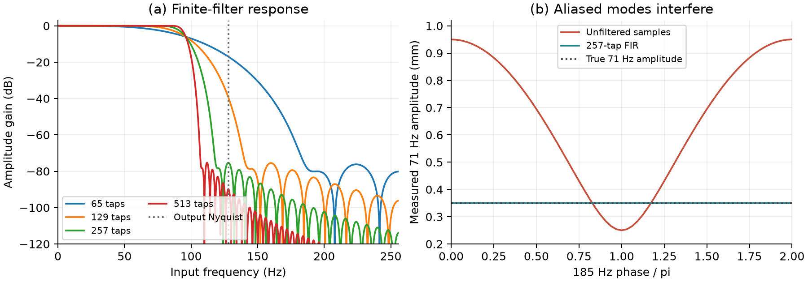

# AliasGuard

**When downsampling makes one vibration mode look like another.** Original C++17
streaming FIR core, Python analysis and analytical verification. Inspired by DTU
MLSP material on discrete-time systems and sampling; [provenance](docs/provenance.md)
records all three DTU folders inspected. No private course material is published.

[Paper PDF](paper/paper.pdf) · [LaTeX source](paper/paper.tex) ·
[Paper build](paper/README.md) · [Recorded metrics](examples/results/metrics.json)



## Research question and measured result

Can an anti-alias filter protect the amplitude of a low vibration mode when a
higher mode folds onto exactly the same sampled frequency? The synthetic sensor
contains 23, 71 and 185 Hz modes. Decimating from 2048 to 256 samples/s makes 185 Hz
indistinguishable from 71 Hz. At zero phase, the measured 71 Hz amplitude becomes
**0.95 mm**, although the true mode amplitude is **0.35 mm**.

| Taps | Delay (ms) | Measured 71 Hz amplitude (mm) | Low-band RMSE (mm) |
| ---: | ---: | ---: | ---: |
| No filter | 0 | 0.9500000 | 0.4242641 |
| 65 | 15.625 | 0.2791422 | 0.0501462 |
| 129 | 31.250 | 0.3352065 | 0.0104612 |
| 257 | 62.500 | 0.3499573 | 0.0000447 |
| 513 | 125.000 | 0.3500163 | 0.0000115 |

The 257-tap result has a **0.01221%** relative amplitude error in this experiment.
A short filter suppresses the high mode but attenuates the desired mode. Stopband
gain at one frequency is not monotone in filter length. These are synthetic results,
not measured structural data or a universal filter specification.

## Governing equations and method

Three independent undamped coordinates satisfy
`q_j'' + (2*pi*f_j)^2*q_j = 0`, with exact solutions
`q_j(t) = A_j*cos(2*pi*f_j*t + phi_j)` and sensor `x(t) = sum_j q_j(t)`.
Amplitudes are (1, 0.35, 0.6) mm. There is no time integrator or spatial mesh.
High-rate acquisition is assumed alias-free: digital filtering cannot undo
aliasing that happened before acquisition.

For odd L and D=(L-1)/2, a Blackman window multiplies
`2*fc/fs * sinc(2*fc/fs*(k-D))`; coefficients are normalized to sum to one.
The 96 Hz cutoff is approximately a half-amplitude point, not the passband edge.
The C++ ring buffer evaluates `y[m] = sum_k h[k]*x[m*R-k]` only at retained indices.
This uses O(L) state and O(N+NL/R) arithmetic for N inputs. Binding conversions
copy chunks. This is direct output-selected convolution, with no FFT/polyphase
speed claim. The symmetric FIR has delay D/fs. The experiment supplies true
prehistory, discards startup and labels samples by center time; this relabeling
does not eliminate acquisition latency.

At output rate F=256 Hz, `cos(2*pi*185*m/F + phi)` equals
`cos(2*pi*71*m/F - phi)`. With real centered gain g, the measured 71 Hz phasor is
`0.35*g(71) + 0.6*g(185)*exp(-i*phi)`. Its amplitude error is bounded by
`0.35*abs(g(71)-1) + 0.6*abs(g(185))`, separating passband distortion from aliasing.
The paper gives the equations and derivation.

## Build, reproduce and check

Requires Python 3.11+ and a C++17 compiler (MSVC Build Tools on Windows or GCC/Clang).
Build isolation provides pybind11 and CMake when needed. Native-only checks need
CMake on PATH.

```sh
python -m venv .venv
# Linux/macOS: source .venv/bin/activate
# PowerShell: .\.venv\Scripts\Activate.ps1
python -m pip install -e ".[dev]"
aliasguard --output examples/reproduced
python -m pytest -q
ruff check .
ruff format --check .
clang-format --dry-run --Werror cpp/fir.hpp cpp/bindings.cpp cpp/test_fir.cpp
cmake -S . -B build/native -DALIASGUARD_PYTHON=OFF
cmake --build build/native --config Release
ctest --test-dir build/native -C Release --output-on-failure
python scripts/check_samples.py
python scripts/check_manifest.py
python -m build
```

The CLI writes metrics JSON, three CSV files and PDF/PNG figures. `--no-plots`
skips rendering. The deterministic experiment uses 2048 output samples (8 s),
four filter lengths and 65 high-mode phases. Use a separate output directory
when experimenting. [Validation notes](docs/validation.md) list reference versions.

## Python and C++ API

```python
import numpy as np
from aliasguard import Decimator, alias_frequency, frequency_response, lowpass

h = lowpass(taps=257, cutoff=96, sample_rate=2048)
stream = Decimator(h, factor=8)
a = stream.process(np.ones(100))
b = stream.process(np.ones(100))
# np.concatenate([a, b]) equals processing 200 samples in one call.
stream.reset()
print(alias_frequency(185, 256))  # 71 Hz
print(frequency_response(h, [71, 185], 2048))  # causal complex gains
```

`process` accepts finite real 1-D inputs and returns float64 output. Output phase
is global input indices 0, R, 2R, ... across chunk boundaries. Initial history is
zero. Nothing is implicitly trimmed or flushed; supply zeros explicitly to drain
the tail. Empty chunks change nothing. Invalid chunks raise before state changes.
`reset()` clears history and phase. The core accepts nonsymmetric filters; the
D/fs delay applies only to odd symmetric coefficients.

The header-only C++ API is `aliasguard::Decimator(coefficients, factor)`,
`process(const std::vector<double>&)` and `reset()`; see `cpp/test_fir.cpp`.
Mutable instances must not be shared concurrently. Extreme finite inputs can
still overflow double precision. Python copies and real-time scheduling are
outside the performance scope.

## Verification, CI and limitations

Tests compare against independent SciPy convolution, filter design and frequency
response, and against analytical harmonic and alias predictions. They exercise
chunk boundaries, startup, reset, invalid inputs, phase reversal and the two-part
error bound. Maximum recorded discrepancies are 3.33e-15 mm for convolution,
2.72e-13 mm for harmonic prediction and 1.46e-13 mm over the phase sweep.
These verify the implementation, not arbitrary physical-signal recovery.

CI checks Ubuntu/Python 3.11 and Windows/Python 3.14, native CTest, formatting,
installed wheels and numerical reproduction. Linux additionally runs address and
undefined-behavior sanitizers. Manuscript CI independently compiles with pdfLaTeX,
rejects more than five pages, undefined references, overfull boxes and stale
input hashes, and uploads rendered pages for visual inspection.

There is no PDE continuum-error estimate: the prescribed modal solution is exact
in time. Low-band RMSE is processing distortion relative to the two desired modes,
not error against the full physical signal. No damping, nonlinearities, noise,
quantization, uncertain parameters or measured structural data are included.
A finite filter has a transition band; rejection of every out-of-band signal is
not guaranteed. Harmonic regression uses known frequencies and is not a general
modal-identification algorithm. No runtime benchmark or novelty claim is made.

## Public references and license

- S. W. Smith, *The Scientist and Engineer's Guide to Digital Signal Processing*:
  [sampling](https://dspguide.com/ch3/2.htm) and
  [windowed-sinc design](https://www.dspguide.com/ch16/2.htm).
- SciPy [`firwin`](https://docs.scipy.org/doc/scipy/reference/generated/scipy.signal.firwin.html),
  [`lfilter`](https://docs.scipy.org/doc/scipy/reference/generated/scipy.signal.lfilter.html) and
  [`freqz`](https://docs.scipy.org/doc/scipy/reference/generated/scipy.signal.freqz.html):
  independent verification routines, not the production streaming core.

MIT license; original implementation and synthetic data.
