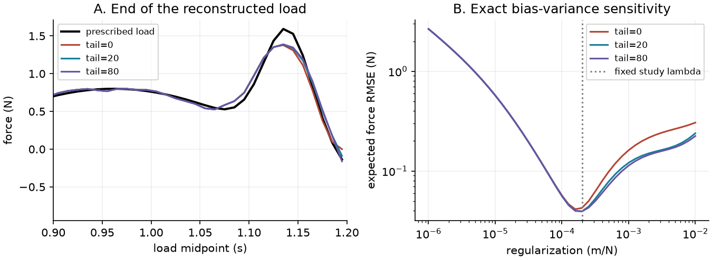

# ForceWindow: the unseen end of a reconstructed load

[](https://github.com/racostacme-come/forcewindow/actions/workflows/ci.yml)

An original C++17/Python scientific-computing project investigating what a finite
displacement record can reveal about an applied force. An exact held-load mechanics
operator and its adjoint support matrix-free Tikhonov inversion. A reproducible study
separates causal non-identifiability, regularization bias, noise, and input approximation.

Read the [academic paper (PDF)](paper/paper.pdf), [LaTeX source](paper/paper.tex),
and [build instructions](paper/README.md). See [validation](docs/validation.md) and
[course provenance](docs/provenance.md). MIT licensed; synthetic data only.



## Main finding

Sampling at the **start** of each load interval leaves the final load completely
unobserved if the record stops there. The inverse returns zero for that coefficient
because of the penalty, not because zero was measured. Recording a known unloaded
tail helps, but one additional sample increases expected reconstruction error in
this example at fixed regularization.

| Extra samples | Expected force RMSE (N) | Expected last-ten RMSE (N) |
| ---: | ---: | ---: |
| 0 | 0.042644 | 0.116009 |
| 1 | 0.045563 | 0.128845 |
| 20 | 0.039427 | 0.101981 |
| 80 | 0.039360 | 0.101765 |

These are square roots of analytical mean-square errors over sensor noise for
one specified load, not physical measurements or universal improvements.
All numerical values are recorded in [metrics.json](examples/results/metrics.json).

## Governing model and method

The initially resting oscillator satisfies `m q'' + c q' + k q = f(t)`.
For `x=(q,v)`, `F=[[0,1],[-k/m,-c/m]]`, `g=[0,1/m]`, the augmented matrix
exponential gives `[[A,b],[0,1]] = exp(dt * [[F,g],[0,0]])`.
Each of the `N` force values is held on `[j*dt,(j+1)*dt)`; force is zero thereafter.
`Window(..., N, tail=L)` returns samples at `0,dt,...,(N+L-1)*dt` in metres.
Forces are newtons, mass kilograms, damping N s/m, and stiffness N/m.

`x[i+1]=A*x[i]+b*f[i]`, `y[i]=[1,0]*x[i]` defines `H`.
The reverse recursion `p[i]=A.T*p[i+1]+[r[i],0]` gives
`(H.T*r)[i]=b.T*p[i+1]` before adding the current residual.
C++ computes both actions in O(N+L) time without storing `H`; Python list
conversions and outputs use O(N+L) memory. No speed benchmark is claimed.

SciPy LSQR solves `min ||H*f-y||² + lambda²*||f||²`, with strictly positive
`lambda` in m/N. There is no smoothness prior or automatic parameter selection.
The study compares this iterative result to independently assembled Markov
parameters and an SVD ridge solution, and evaluates exact bias-plus-variance risk.

## Install and run

Requires Python 3.11+, CMake 3.20+, and a C++17 compiler. On Windows install
Visual Studio C++ Build Tools and a Windows SDK; Linux can use GCC/G++.
The pip build installs scikit-build-core and pybind11 in an isolated build environment.

```sh
python -m venv .venv
# Linux/macOS: source .venv/bin/activate
# PowerShell: .\.venv\Scripts\Activate.ps1
python -m pip install ".[dev]"
forcewindow --output examples/results
python -m pytest -q
python scripts/check_samples.py
ruff check .
ruff format --check .
clang-format --dry-run --Werror cpp/bindings.cpp cpp/state.hpp cpp/test_state.cpp
python -m build
```

For development use `pip install -e ".[dev]"`; rebuild after C++ changes.
The CLI writes JSON, two CSV tables, and PDF/PNG plots into the chosen directory.
It overwrites those named outputs when rerun. The checked-in outputs use NumPy
seed 20261013; floating-point iteration counts can differ across platforms.
[requirements-recorded.txt](requirements-recorded.txt) records the key local tool versions;
the dependency ranges in `pyproject.toml` also permit other tested Python versions.

```python
import numpy as np
from forcewindow import Oscillator, Window, reconstruct

operator = Window(Oscillator(mass=1, damping=0.8, stiffness=100), 0.01, 120, tail=20)
force = np.sin(np.arange(120) * 0.08)
displacement = operator @ force
estimate, diagnostics = reconstruct(operator, displacement, regularization=2e-4)
print(diagnostics)
```

`Window` is a SciPy `LinearOperator` with `matvec` and `rmatvec`. Real column vectors
are accepted; non-finite and complex inputs are rejected. `dense()` is restricted
to four million entries for small diagnostic cases. A window is limited to ten
million samples to prevent accidental excessive allocations. `reconstruct` returns
the force and LSQR termination/residual diagnostics; it raises on nonconvergence.

To build and run standalone native tests after installing `pybind11`:

```powershell
$bindPath = python -c 'import pybind11; print(pybind11.get_cmake_dir())'
cmake -S . -B build/native "-Dpybind11_DIR=$bindPath"
cmake --build build/native --config Release
ctest --test-dir build/native -C Release --output-on-failure
```

On Bash replace the first two lines by
`cmake -S . -B build/native -Dpybind11_DIR="$(python -c 'import pybind11; print(pybind11.get_cmake_dir())')"`.

## Limits and evidence

The held-load step response agrees with the analytical displacement to
`1.48e-17 m` in the recorded run. Maximum LSQR/SVD force discrepancy is `3.90e-9 N`.
A smooth sine input approximated by midpoint held loads shows about second-order
displacement convergence; this is a forcing approximation error, not a propagation
error or a spatial mesh study. See the paper for assumptions and full data.

This project assumes known parameters, zero initial state, equal-variance independent
displacement noise, and exactly zero force after the load window. Real sensors,
unknown initial states, model mismatch, nonlinearities, and unexpected tail forces
are not validated. Longer tails observe a two-dimensional terminal state and cannot
identify unlimited independent load directions. Dense SVD risk analysis is for
small studies. No physical validation, optimal tuning, or novel-method claim is made.

## Public references

- Paige and Saunders (1982), LSQR, ACM TOMS 8(1), 43-71:
  [Stanford SOL reference and software](https://web.stanford.edu/group/SOL/software/lsqr/).
- SciPy [zero-order-hold state-space conversion](https://docs.scipy.org/doc/scipy/reference/generated/scipy.signal.cont2discrete.html)
  and [LSQR](https://docs.scipy.org/doc/scipy/reference/generated/scipy.sparse.linalg.lsqr.html).
