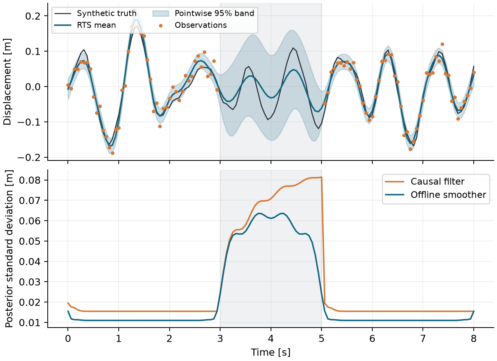

# GapSmooth

**How much can future vibration measurements reduce uncertainty inside a sensor outage?**

GapSmooth implements an exactly sampled stochastic oscillator, a Joseph-form
Kalman filter, and a Rauch-Tung-Striebel (RTS) smoother. An independent dense
Gaussian conditioning reference verifies posterior moments and likelihoods.
All examples are synthetic and generated by this repository.



At the center of the recorded two-second outage, future observations reduce
displacement variance by **25.44%**: standard deviation falls from **0.07077 m**
to **0.06111 m**. This is a conditional-model result, not physical validation
or a guarantee for other structures. The smoother uses future data and is offline.

Read the original manuscript: [PDF](paper/paper.pdf) ·
[LaTeX source](paper/paper.tex) · [build provenance](paper/validation.json).

## Model and numerical method

For a mass-normalized, one-degree-of-freedom oscillator, with displacement x
and velocity v,

```math
dz=A z\,dt+L\,dW,\quad z=[x,v]^T,\quad
A=\begin{bmatrix}0&1\\-\omega^2&-2\zeta\omega\end{bmatrix},\quad
LL^T=\operatorname{diag}(0,q).
```

Displacement observations obey `y_k = [1,0] z_k + epsilon_k`, with independent
Gaussian measurement variance R. Exact sampled moments are
`F(h)=exp(Ah)` and `Q(h)=integral_0^h exp(As) LL^T exp(A^T s) ds`.
The code evaluates a scaled 4x4 block exponential and composes moments by
doubling, avoiding unstable growth in the auxiliary exponential for long gaps.

The filter predicts with F,Q and updates observed samples using the Joseph
covariance formula. NaN observations skip the update; infinity is rejected.
The RTS backward pass solves for its gains without explicitly inverting matrices.
The prior belongs to the first supplied time, before its measurement.
Irregular sampling is supported; times must be finite and strictly increasing.
Positive damping/frequency, nonnegative process intensity, a positive definite
prior, and strictly positive scalar measurement variance are required.

## Install and use

Python 3.11+ is required. No compiler is needed. SciPy supplies compiled linear
algebra; a separate C++ binding would add little value for these 2x2 states.
Other projects in the series contain C++ numerical cores.

```sh
python -m venv .venv
# Linux/macOS: source .venv/bin/activate
# Windows PowerShell: .\.venv\Scripts\Activate.ps1
python -m pip install -e ".[dev]"
gapsmooth --output reproduced --trials 256
python -m pytest -q
ruff check .
ruff format --check .
python scripts/check_samples.py
python -m build
```

The CLI writes metrics.json, trace.csv, outage.png, outage.pdf and refinement.pdf.
Existing files of those names in the output folder are replaced. No timing
benchmark is claimed. `--trials 16` is an exploratory run, not the published study.

```python
import numpy as np
from gapsmooth.model import Oscillator
from gapsmooth.inference import infer, simulate

model = Oscillator(omega=2 * np.pi, zeta=0.08, q=0.6)
times = np.arange(129) / 16
p0 = model.stationary_covariance
truth, y = simulate(model, times, 0.02**2, [0, 0], p0, seed=2718)
y[(times >= 3) & (times <= 5)] = np.nan
result = infer(model, times, y, 0.02**2, [0, 0], p0)
print(result.smoothed_mean.shape)  # (129, 2): displacement, velocity
print(result.nll)  # observed-data negative log likelihood
```

`Oscillator.transition(h)` returns `(F,Q)`. `infer` returns filtered/smoothed
means `(N,2)`, covariances `(N,2,2)`, scalar innovations and their variances
`(N,)`, and NLL. Missing innovation entries are NaN. `batch_condition` in
`gapsmooth.reference` returns the full Gaussian posterior and NLL for <=256
times; it is a verification tool with quadratic storage and cubic solves.

## Recorded validation

The numerical authority is [metrics.json](examples/results/metrics.json).
Recorded local results:

| Check | Measured value |
| --- | ---: |
| Maximum batch/RTS mean difference | 5.55e-16 |
| Maximum batch/RTS covariance difference | 1.25e-16 |
| Absolute batch/filter NLL difference | 8.88e-16 |
| Maximum Q difference from adaptive quadrature | 1.39e-17 |
| Stationary covariance identity discrepancy | 2.22e-16 |
| Mean state NEES at t=4 s, filter / smoother | 1.949 / 1.912 |
| Expected 95% mean NEES interval, 256 independent trials | [1.762, 2.252] |
| Displacement 95% interval coverage, filter / smoother | 96.88% / 97.66% |

Exact transitions have no time-stepping truncation error for this linear SDE.
Euler refinement compares the same moments at one second, not unrelated random
paths. Tests cover semigroup composition, long/tiny intervals, stationary covariance,
zero forcing, missing data, prefix filtering, covariance reduction and input errors.
CI tests Linux/Python 3.11 and Windows/Python 3.14, reproduces the study with
rounding tolerances, builds wheel/sdist, and tests the installed wheel.

## Manuscript build

Install Tectonic or TeX Live (`pdflatex`, recommended fonts and LaTeX packages).
Install Poppler for rendering. From the repository root:

```sh
python paper/build.py --engine tectonic
# Alternative: python paper/build.py --engine pdflatex
python scripts/check_manifest.py
pdftoppm -r 120 -png paper/paper.pdf paper/build/page
```

The build generates numbers.tex from committed metrics, compiles the source,
rejects undefined citations/references and overfull boxes, enforces 1-5 pages,
and records SHA-256 hashes of numerical/source inputs and the PDF. CI repeats
compilation and uploads the PDF, logs and page images. Visual review is separate;
the script does not pretend to judge visual quality.

## Scope, provenance and limitations

Primary inspiration: DTU ATSA state-space modelling and Kalman estimation,
identified in the actual lecture outline and connected to structural vibration.
[Provenance](docs/provenance.md) records inspected topics in all three DTU folders.
No private notes, exercises, solutions or data are included.

Parameters are known and fixed; forcing and sensor errors are Gaussian and
independent. There is no parameter identification, nonlinear mechanics, colored
forcing, robust outlier handling, multi-sensor support, or experimental calibration.
White acceleration noise is an idealization. Pointwise bands are not simultaneous
trajectory bands. Monte Carlo consistency cannot establish real-world validity.
Covariance-form arithmetic may lose accuracy in extreme conditioning; this is
not a square-root filter. See [validation notes](docs/validation.md).

## Public references

- S. Särkkä and A. Solin, *Applied Stochastic Differential Equations*, Cambridge
  University Press, 2019, Chapters 6 and 10.
  [Author-hosted text](https://users.aalto.fi/~asolin/sde-book/sde-book.pdf).
- S. Särkkä and L. Svensson, *Bayesian Filtering and Smoothing*, second edition,
  Cambridge University Press, 2023.
  [Author-hosted text](https://users.aalto.fi/~ssarkka/pub/bfs_book_2023_online.pdf).

MIT licensed. Original educational research software; no claim of new filtering
theory, peer review or experimental validation.
