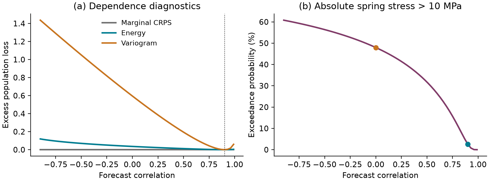

# JointGuard

**Correct displacement marginals can conceal a wrong internal-force forecast.**
JointGuard evaluates probabilistic predictions for an original two-displacement
elastic system using a C++17 ensemble energy-score core and Python Gaussian
diagnostics. It separates dependence errors, common displacement bias, finite
ensemble effects, and the risk of a specified spring-stress exceedance.



[Research paper (PDF)](paper/paper.pdf) · [LaTeX source](paper/paper.tex) ·
[Recorded metrics](results/metrics.json) · [Course provenance](docs/provenance.md)

## Result in one experiment

With unit displacement variances and true correlation 0.9, treating responses
as independent leaves marginal CRPS unchanged at **0.56419**. Yet it raises
predicted absolute central-spring stress exceedance from **2.535% to 47.950%**,
an **18.92-fold** change. A common displacement bias of one standard deviation
instead leaves the variogram score and central-spring risk unchanged, but joint
energy/log scores and marginal CRPS detect it. These are results for a declared
synthetic Gaussian population, not evidence of a physical failure probability.

## Governing equations and method

Three linear springs of stiffness `k = 1e6 N/m` connect two displacements to
ground and to each other:

```text
K u = f,  K = k [[2, -1], [-1, 2]]
f ~ Normal(0, K (s² C) Kᵀ),  s = 1 mm,  C = [[1, 0.9], [0.9, 1]]
u ~ Normal(0, s² C)
central-spring stress proxy = k (u₂ - u₁) / A,  A = 1e-4 m²
event |stress| > 10 MPa  <=>  |u₂/s - u₁/s| > 1
```

The model is quasi-static and linear. The area and threshold are illustrative.
All scores use `X = u/s` and the same coordinate scale. Lower scores are better:

- **Marginal CRPS:** mean of univariate Gaussian CRPS values.
- **Joint LogS:** negative log Gaussian density, evaluated with Cholesky solves.
- **Energy:** `E||X-y|| - 0.5 E||X-X'||`, with Euclidean norm.
- **Variogram:** mean of `(|y_i-y_j| - E|X_i-X_j|)²` over unordered pairs.

For iid ensemble members, the energy estimator subtracts the unordered pair
distance sum divided by `M(M-1)` from the mean observation distance. The default
`unbiased=True` estimates the underlying distribution's score. Setting it to
`False` uses `M²`, scoring the finite empirical distribution instead. The latter
has expected excess `E||X-X'||/(2M)` relative to the population score. The iid
correction is inappropriate for dependent ensemble members.

The C++ core takes `O((M² + NM)d)` work and `O(N)` extra memory, avoiding a
distance matrix. Gaussian population energy expectations use a one-dimensional
Laplace-transform integral with scale normalization and adaptive quadrature;
the other population scores and linear-event probabilities use closed forms.
See the paper for the derivation and the limits of the quadrature error estimate.

## Build and install

Requires Python 3.11+, CMake 3.20+ and a C++17 compiler (MSVC Build Tools on
Windows, GCC/Clang on Linux/macOS). A source install compiles the native module;
there is no silent Python fallback. Python build dependencies install automatically.

```bash
python -m venv .venv
# Linux/macOS: source .venv/bin/activate
# Windows PowerShell: .venv\Scripts\Activate.ps1
python -m pip install -e ".[dev]"
jointguard --output results
python examples/quickstart.py
```

The CLI writes to the specified directory (existing generated files there are
replaced). For a separate reproduction use `--output build/reproduced`.
The current implementation exposes fixed study parameters; customize models
through the API. Dependency ranges are in `pyproject.toml`; the observed local
environment is in `requirements-recorded.txt` and is not a cross-platform lock.

## API

```python
import numpy as np
from jointguard import Gaussian, elastic_response, energy_score, expected_scores

truth = Gaussian([0, 0], [[1, 0.9], [0.9, 1]])
forecast = Gaussian([0, 0], np.eye(2))
print(expected_scores(forecast, truth))
print(forecast.exceedance([-1, 1], threshold=1))
observations = np.array([[0.2, 0.1], [0.4, -0.1]])
ensemble = np.random.default_rng(42).normal(size=(128, 2))
print(energy_score(ensemble, observations))  # one loss per observation
print(forecast.log_score(observations))
print(forecast.marginal_crps(observations))
print(forecast.variogram_score(observations))
response = elastic_response([[2, -1], [-1, 2]], forecast)
```

`Gaussian(mean, covariance)` copies inputs, makes its arrays read-only, and
requires a finite symmetric positive-definite covariance. `elastic_response`
also requires SPD stiffness. `energy_score` accepts finite `(M,d)` and `(N,d)`
arrays, including strided arrays; default scoring needs at least two members.
It raises `ValueError` for invalid input and `OverflowError` for nonfinite score
arithmetic. `expected_scores` and variograms require at least two dimensions.
Use consistently scaled, reasonably conditioned inputs; extreme magnitudes and
near-singular matrices are outside the validated regime.

## Reproduce and verify

```bash
python -m pytest -q
python scripts/check_results.py
ruff check .
ruff format --check .
clang-format --dry-run --Werror cpp/bindings.cpp cpp/energy.hpp cpp/test_energy.cpp
python -m build
```

The reproduction script compares all JSON metrics and all 164 CSV rows with
`rtol=2e-9, atol=2e-12`, and checks the formatted population table exactly.
Roundoff residuals are also required to stay below `1e-12`. PNG bytes and
rounded residual macros may vary between library versions; substantive values
are checked numerically. Generated paper inputs and the committed PDF are
verified separately by cryptographic hashes.

For native CTest from an activated environment:

```bash
# bash
cmake -S . -B build/native -Dpybind11_DIR="$(python -c 'import pybind11; print(pybind11.get_cmake_dir())')"
cmake --build build/native --config Release
ctest --test-dir build/native -C Release --output-on-failure
```

```powershell
# PowerShell: get_cmake_dir avoids embedded quotes in paths containing spaces.
$pybindDir = python -c 'import pybind11; print(pybind11.get_cmake_dir())'
cmake -S . -B build/native "-Dpybind11_DIR=$pybindDir"
cmake --build build/native --config Release
ctest --test-dir build/native -C Release --output-on-failure
```

Tests include independent SciPy distance/density oracles, chi and folded-normal
norm identities, covariance equilibrium, coordinate invariances, and invalid
inputs. The recorded core/distance discrepancy is `6.66e-16`; the equilibrium
covariance residual is `4.90e-16` relative. These are observed roundoff-scale
residuals, not reliable portable digits. No runtime speedup is claimed.

The stochastic study uses seed 20261020, 24 independent replicates, 128 members
and 256 observations per replicate. The calibrated unbiased energy mean is
0.82363 with replicate standard error 0.00670, compared with population 0.82669.
Standard errors include ensemble and observation variation. A deterministic
four-standard-error regression check is not a universal statistical guarantee.

## Manuscript

Install TeX Live with `amsmath`, `amssymb`, `booktabs`, `geometry`, `graphicx`,
`hyperref`, `lmodern`, and `microtype`, or use Tectonic:

```bash
python scripts/build_paper.py                 # auto-detect pdflatex or tectonic
python scripts/build_paper.py --engine /path/to/tectonic
python scripts/build_paper.py --verify        # hashes and 1-5 page check
```

The script builds `paper/paper.pdf`, rejects undefined references and overfull
boxes, and records source/artifact hashes in `paper/build-report.json`. Changes
to results require rebuilding the paper. Rebuilding with a different TeX engine
may change PDF bytes. CI builds the manuscript independently with pdfLaTeX,
checks its page count and uploads page renders for review. Local visual review
and validation details are recorded in [validation notes](docs/validation.md).

## Scope and limitations

This is forecast evaluation, not forecast fitting, optimization or design
certification. The elastic model is prescribed and has no continuum reference;
no mesh-convergence claim is made. Finite ensemble error is distinct from
quadrature and roundoff error. Numerical agreement does not validate physical
assumptions, tail calibration or the chosen stress threshold. The paper reports
one synthetic Gaussian setting, not a universal ranking of scoring rules.
The variogram cannot see common shifts. Energy is not correlation-blind, and
scores have different scales. Singular covariances, dependent ensembles,
nonlinear mechanics and physical measurements are not covered.

## Public references and provenance

- Gneiting & Raftery (2007), *Strictly Proper Scoring Rules, Prediction, and
  Estimation*, JASA 102:359-378.
  [Publisher](https://doi.org/10.1198/016214506000001437).
- Scheuerer & Hamill (2015), *Variogram-Based Proper Scoring Rules for
  Probabilistic Forecasts of Multivariate Quantities*, MWR 143:1321-1334.
  [Publisher](https://doi.org/10.1175/MWR-D-14-00269.1),
  [NOAA record](https://repository.library.noaa.gov/view/noaa/22327/).

Grounded in DTU ATSA's actual available multivariate forecast-evaluation lecture;
see [provenance](docs/provenance.md). No private course material is included.
Original code and documentation are released under the [MIT license](LICENSE).
