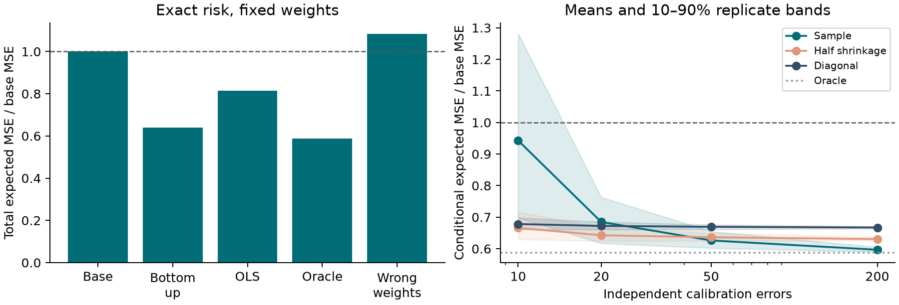
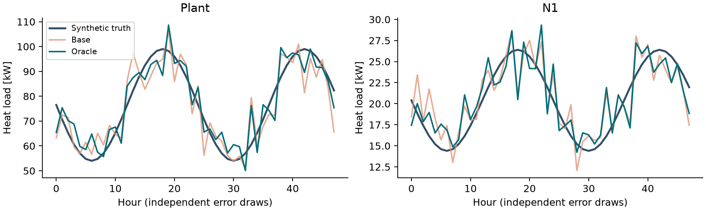

# LoadCoherent: coherence is not accuracy

Can aggregation-consistent district heat-load forecasts still be worse?
**Yes.** In this original synthetic study, oracle reconciliation reduces expected
total squared error by **41.19%**, while deliberately wrong weights increase it
by **8.25%**. With ten training errors, the unshrunk covariance estimator exceeds
the base risk in **20 of 80** independent calibration trials. Fixed 50% diagonal
shrinkage stabilizes that case but has higher mean risk than the sample estimator
at 200 training errors. These are results for one known synthetic distribution.



[Academic manuscript (PDF)](paper/paper.pdf) · [LaTeX source](paper/paper.tex) ·
[Validation design](docs/validation.md) · [Course/topic provenance](docs/provenance.md)

## Model and numerical method

Four buildings form two districts and one plant: node order is plant, north,
south, N1, N2, S1, S2. With conductances U = (1.2, 0.8, 1.5, 1.0) kW/K,
indoor temperature 21 degrees C and outdoor temperature
T_out(t) = 4 + 5 sin(2 pi t / 24) degrees C, the quasi-steady loads are

$$b_i(t)=U_i[21-T_{out}(t)],\qquad y=S b,$$

where S contains rows (1,1,1,1), (1,1,0,0), (0,0,1,1) and the 4 by 4 identity.
Pipes are lossless, storage is ignored, and heating meets demand exactly.
This is an algebraic thermal-loss model, not a transient building or pipe solver.

Synthetic base predictions satisfy hat(y) = y + e with Gaussian errors of
covariance V. An SPD weight W defines the reconciled prediction S beta where

$$\beta=\arg\min_z\|L^{-1}(S z-\hat y)\|_2^2,\qquad LL^T=W.$$

The implementation uses Cholesky whitening, reduced QR and triangular solves;
it does not form W inverse or the normal equations. The resulting projection P
satisfies PS = S, P squared = P, and exact aggregation up to floating-point error.
For fixed P and error mean mu, the analytical per-node MSE is

$$\operatorname{diag}(P V P^T)+(P\mu)\odot(P\mu).$$

W=V is the oracle MinT reference for unbiased errors. Estimated weights use
centered sample covariance shrunk as W_alpha=(1-alpha) V_sample +
alpha diag(V_sample), with alpha in {0, 0.5, 1}; 0.5 is fixed, not optimized.
Coherent bias survives reconciliation. Scalar trace risk sums MSE across *all
seven targets*, including overlapping aggregates; it is not a physical energy.

## Install and reproduce

Python 3.11 or newer is required. No C++ compiler is needed for this small dense
project; earlier projects in the series provide C++ cores.

```sh
python -m venv .venv
# Windows: .venv\Scripts\activate
# Linux/macOS: source .venv/bin/activate
python -m pip install -e ".[dev]"
loadcoherent --output examples/results
python -m pytest -q
python -m ruff check .
python -m ruff format --check .
python scripts/check_samples.py
python scripts/check_manifest.py
python -m build
```

`requirements-reproduced.txt` records exact package versions from the local
Windows/Python 3.14 run. It is an environment record, not a universal lockfile.
The package metadata permits compatible versions tested by CI. To reproduce
the recorded environment, install that file before installing this package.
CSV files use explicit LF line endings. JSON/CSV numerical comparisons allow
small platform-dependent floating-point differences.

## Python API

```python
import numpy as np
from loadcoherent import Reconciler, estimate_covariance, prediction_mse

S = np.array([[1, 1], [1, 0], [0, 1]])
W = np.diag([9, 1, 4])
model = Reconciler(S, W)
coherent = model.reconcile([30, 10, 15])  # vector or batch (..., nodes)
assert np.isclose(coherent[0], coherent[1] + coherent[2])
node_mse = prediction_mse(model.projection, W)
# Use held-out historical forecast errors for actual calibration:
training_errors = np.array([[1, 2, 1], [-1, 0, 2], [2, 1, -1], [0, -1, 0]])
estimated = estimate_covariance(training_errors, shrinkage=0.5)
```

`Reconciler(S, W)` accepts a real full-column-rank matrix S and a well-conditioned
SPD W. `.bottom_map` and `.projection` return defensive copies. The relative
weight eigenvalue and whitened singular-value cutoffs are 1e-12. Invalid shapes,
nonfinite/complex values, near-singular weights and deficient designs raise
`ValueError`. No hidden jitter or pseudoinverse changes the stated model.
`estimate_covariance` requires at least two rows and positive variance at every
node; alpha=0 may produce singular weights and is intentionally not repaired.
`prediction_mse` requires that the supplied projection preserve the true signal;
that assumption cannot be checked from its inputs alone.

## Recorded experiment

Seed 20261008 spawns independent test, calibration and display random streams.
V is generated from three shared error factors and independent node residuals;
all values are in `study.district()` and `examples/results/metrics.json`.
There are 60,000 test draws for fixed methods and 80 independent calibration sets
for each of 10, 20, 50 and 200 samples. Each fitted projection is scored with
the known population covariance, eliminating test noise from its conditional
risk. No held-out outcome chooses a method or a shrinkage value.

| Fixed method | Expected sum of node MSE [kW²] | Ratio to base |
|---|---:|---:|
| Base | 128.6500 | 1.000000 |
| Bottom up | 82.2000 | 0.638943 |
| OLS | 104.7000 | 0.813836 |
| Oracle | 75.6632 | 0.588132 |
| Wrong weights | 139.2623 | 1.082489 |

Every fixed-method Monte Carlo mean lies within 1.02 analytic standard errors
of its population value. Independent KKT and QR forecasts differ by 1.42e-14 kW
in the recorded example. The 48-hour display path's maximum aggregation residual
falls from 11.8785 kW to 1.78e-14 kW. The analytical oracle risk, not this single
illustrative path, supports the improvement claim.



## Manuscript and CI

Install Tectonic or TeX Live (`pdflatex`), then run:

```sh
python paper/build.py --engine tectonic
# or: python paper/build.py --engine pdflatex
python scripts/check_manifest.py
pdftoppm -r 110 -png paper/paper.pdf paper/build/page
```

The build reads recorded numbers, creates `numbers.tex`, compiles, rejects
undefined references and overfull boxes, checks at most five nonempty pages,
and records hashes of manuscript inputs and the PDF. See [paper guide](paper/README.md).
CI runs numerical checks on Ubuntu/Python 3.11 and Windows/Python 3.14, builds
the wheel and sdist, reruns tests from the installed wheel, and compiles the
paper independently with pdfLaTeX. Its manuscript artifact includes every page
as PNG for review. The PDF shipped here was also rendered and visually checked.

## Scope and limitations

- Synthetic independent Gaussian errors; no actual forecast model is trained.
- One covariance and one hierarchy; finite replicate statistics are not universal
  probabilities. Fixed half-shrinkage is not claimed optimal.
- Exact aggregation assumes no pipe losses/storage or missing nodes. Physical
  validity has not been established by measurements.
- Coherence neither enforces nonnegative demand nor corrects coherent bias.
  Adding 2 kW bias per building adds 112 kW² to the all-node oracle risk.
- Dense O(n³) fitting targets small systems. No performance benchmark is claimed.
- There is no continuum discretization or mesh-convergence error in this
  algebraic model. Numerical projection error and statistical risk are separate.

## References and license

- Wickramasuriya, Athanasopoulos and Hyndman (2019), *Optimal forecast
  reconciliation for hierarchical and grouped time series through trace
  minimization*, JASA 114(526), 804–819.
  [Author record and DOI](https://robjhyndman.com/publications/mint/).
- Hyndman and Athanasopoulos (2021), *Forecasting: Principles and Practice*,
  3rd edition, §11.3, [Forecast reconciliation](https://otexts.com/fpp3/reconciliation.html).

MIT license. Public references support the established methodology; the numerical
experiments, implementation and prose are original to this repository. Course
material was used solely for private topic selection and is not redistributed.
