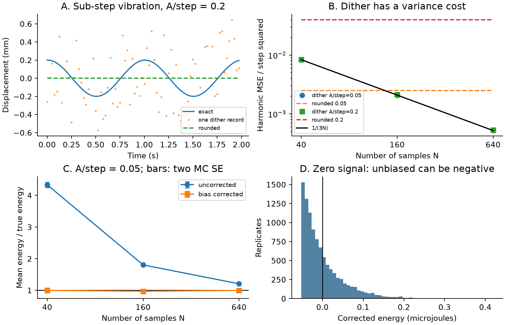

# QuantFlex

**A longer record cannot recover vibration that ordinary rounding erases at every
sample.** Subtractive dither restores unbiased harmonic coefficients under stated
conditions, but adds variance and need not reduce mean-square error. This original
study measures that tradeoff and the finite-sample bias in elastic-energy estimates.

[Research paper (PDF)](paper/paper.pdf) | [LaTeX source](paper/paper.tex) |
[Concept provenance](docs/provenance.md) | [Recorded metrics](results/metrics.json)



## Model and method

The steady oscillator obeys `m u'' + c u' + k u = F cos(omega t)`. With
`H = F/(k - m omega^2 + i c omega)`, displacement is
`u(t) = Re(H) cos(omega t) - Im(H) sin(omega t)`. No time integrator is used.

The midtread quantizer is `Q(x) = delta floor(x/delta + 1/2)` (ties upward).
Subtractive dither gives `y = Q(u+d)-d` with independent uniform dither samples
on `[-delta/2, delta/2)`. Without overload, errors have mean zero and variance
`delta^2/12`. Ordinary rounding generally does not satisfy this noise model.
Optional symmetric code saturation is reported by a mask.

The design matrix columns are `[1, cos(omega*t), sin(omega*t)]`. Reduced QR gives
`L = solve(R, Q.T)`; coefficients are `L y`, covariance is `C = variance * L L.T`.
No normal equations are solved. For coherent integer cycles, harmonic coefficient
MSE is `delta^2/(3N)` under the unclipped iid dither model.

Cycle-average oscillatory spring energy is `E = k(a^2+b^2)/4`. Squaring noisy
coefficients adds bias `k trace(C_h)/4`, where `C_h` is the harmonic block.
Subtracting this bias yields an unbiased estimate under the same conditions.
Negative estimates are retained: clamping creates positive bias. DC offset and
preload energy are excluded.

## Install and run

Requires Python 3.11+; no compiler is needed. NumPy and Matplotlib are runtime
dependencies. Vectorized three-parameter fits do not justify a native extension;
other repositories in the series use C++17 numerical cores.

```sh
python -m venv .venv
# Linux/macOS: source .venv/bin/activate
# PowerShell: .venv\Scripts\Activate.ps1
python -m pip install -e ".[dev]"
python examples/quickstart.py
quantflex --output build/my-study
```

The CLI writes JSON metrics, two CSV files, a figure and generated LaTeX tables
and macros. The default output directory is `results`; specify `--output results`
only when deliberately replacing the recorded study. A full study has 14 cases
with 10,000 realizations each; the largest sample matrix is 10,000 by 640.

```python
import numpy as np
from quantflex import HarmonicModel, quantize, elastic_energy

model = HarmonicModel(np.arange(160) / 40, 2 * np.pi)
signal = model.design @ np.array([0.0, 0.0002, 0.0001])
step = 0.001
dither = np.random.default_rng(42).uniform(-step / 2, step / 2, signal.shape)
record = quantize(signal, step, dither=dither)
beta = model.fit(record.values)
C = model.covariance(step**2 / 12)
energy = elastic_energy(beta, 100, covariance=C)
```

`fit` accepts vectors or batches with samples in the last axis. Coefficients are
`[DC, cosine, sine]`. Docstrings define shapes, units and input restrictions.
Covariance takes a **known iid noise variance**; it does not infer independence.
The quantizer cannot certify independent dither. `max_code=M` clips codes to
`[-M,M]`, a pedagogical symmetric converter; inspect `record.saturated`.

## Reproduction and measured results

Synthetic parameters: `m=1 kg`, `c=0.4 N s/m`, `k=100 N/m`, forcing frequency 1 Hz,
sample rate 40 Hz, step 1 mm. Amplitude/step ratios 0.05, 0.2, 0.8 and 2 are crossed
with 40, 160 and 640 samples; a zero signal and saturated case complete the study.
Force amplitude follows the exact dynamic stiffness. Seeds start at 20261020 in
amplitude-major order, followed by zero and saturated cases. Record length extends
duration at fixed sample rate, not temporal resolution.

- At amplitude/step 0.05, rounded harmonic MSE/step squared is 0.0025 for every
  record length. Dither yields 0.00827 at 40 samples and 0.00052 at 640 samples.
- Across 13 unclipped cases, maximum absolute standardized discrepancies are
  1.918 for a coefficient mean, 1.911 for harmonic MSE and 2.031 for corrected
  energy. Standardization uses Monte Carlo standard errors; these are not exact
  confidence intervals. Observations support but do not prove the theory.
- At zero signal, 63.84% of corrected energy estimates are negative.
- Saturating 43.60% of codes leaves mean corrected energy at 37.10% of the reference:
  an unclipped noise correction cannot repair overload bias.
- QR and independent least-squares estimates agree within 1.74e-18 m locally.

```sh
ruff check .
ruff format --check .
python -m pytest -q
python scripts/check_results.py
python -m build
python scripts/build_paper.py --verify
```

Tests cover ties, clipping masks, deterministic integration of dither moments,
a separate real dynamic-equilibrium system, cycle-energy integration,
nonuniform-time least squares, analytical covariance, Monte Carlo energy
correction and invalid inputs. Reproduction checks every JSON number and all
174 CSV rows with explicit tolerances. CI checks Linux/Python 3.11 and
Windows/Python 3.14, builds source/wheel archives, tests the installed wheel,
and independently builds and renders the paper. See the actual executed
[validation record](docs/validation.md).

## Manuscript build

Install TeX Live with `pdflatex` (`texlive-latex-extra`, `texlive-science`,
`texlive-fonts-recommended`, `lmodern`) or install Tectonic.

```sh
python scripts/build_paper.py
# Or: python scripts/build_paper.py --engine /path/to/tectonic
python scripts/build_paper.py --verify
# Create paper/build before rendering:
pdftoppm -scale-to 1400 -png paper/paper.pdf paper/build/page
```

The build rejects unresolved references and overfull boxes, requires 1-5 pages,
and hashes numerical code, results, manuscript inputs and PDF. Rebuild after
changing a hashed input. CI uploads its independent PDF and every rendered page.
Reproducibility is numerical, not byte-identical PNGs across font libraries.

## Limitations

One synthetic linear oscillator with exact frequency and steady response is
studied. Analog noise, nonuniform quantizers, timing errors, imperfect dither
subtraction, transients and correlated errors are outside scope. Saturation
invalidates the covariance assumption. Dither need not help every signal.

Discrete arithmetic checks and statistical errors are separate. There is **no
continuum discretization or convergence claim**, physical experiment, hardware
implementation, metrology certification, optimality or speedup claim. Inputs
outside supported floating-point ranges and ill-conditioned designs are rejected.
Negative energy estimates do not imply negative physical spring energy.

## References, provenance and license

The topic comes from the inspected DTU MLSP chapter on sampling and quantization.
ATSA and MMME were also inspected read-only. No private course material is
included. Code, synthetic experiments, figures and manuscript are original.

- Lipshitz, Wannamaker and Vanderkooy (1992),
  [Quantization and Dither: A Theoretical Survey](https://aes.org/publications/elibrary/elibrary-page/?id=7047).
- Rapp, Dawson and Goyal (2019),
  [Estimation from Quantized Gaussian Measurements: When and How to Use Dither](https://arxiv.org/abs/1811.06856).

MIT license; see [LICENSE](LICENSE). No institutional affiliation, endorsement,
peer review or novelty of the established dither theorem is asserted.
